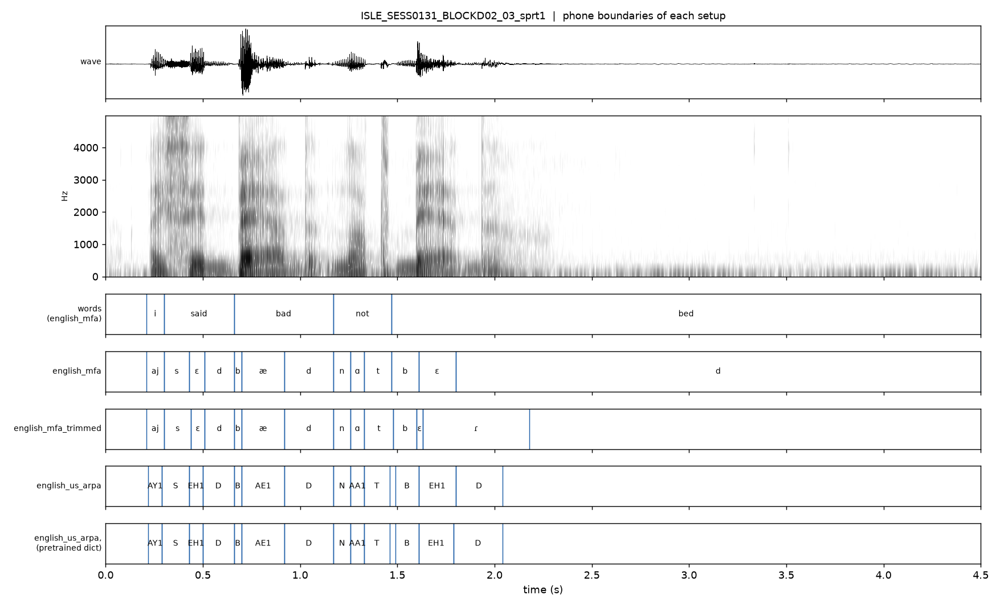

# Forced alignment with the Montreal Forced Aligner (Assignment 2a)

Word- and phone-level forced alignment of the six provided recordings with the Montreal Forced Aligner (MFA)
3.4.3. Four setups are compared: two pretrained acoustic models, a custom pronunciation dictionary built with
MFA's G2P model for words the pretrained dictionaries lack, and a remedy for the one systematic error found. The
aligner is also used as a pronunciation checker for the non-native minimal pairs. One command runs it all.

| | |
|---|---|
| Data | 3 BU Radio News clips (speaker f2b, read news, 25–31 s) and 3 ISLE clips (non-native speaker, "I said X not Y" minimal pairs, 4 s) |
| Acoustic models | `english_us_arpa` (ARPAbet phones) and `english_mfa` (IPA-style phones) |
| Dictionaries | pretrained `english_us_arpa` / `english_us_mfa`, plus G2P pronunciations for the 4 out-of-vocabulary words |
| Outputs | TextGrids in [`outputs/textgrids/`](outputs/textgrids), figures in [`outputs/figures/`](outputs/figures), tables in [`outputs/analysis/`](outputs/analysis) |
| Report | [`report/report.pdf`](report/report.pdf) |

## Results in short

| Setups compared (244 words, 488 word boundaries) | Median difference | Within 20 ms | Within 50 ms |
|---|---|---|---|
| `english_us_arpa` vs `english_mfa` | 10 ms | 90.2 % | 96.3 % |
| `english_us_arpa` vs `english_mfa_trimmed` | 10 ms | 89.3 % | 96.1 % |
| `english_us_arpa`: pretrained vs G2P dictionary | 0 ms | 99.2 % | 100 % |

- **Unknown words:** with the pretrained dictionary, the 5 tokens of *Dukakis, Maffy, Melnicove, politicize* are
  aligned as the filler `spn` with no phones. The G2P dictionary gives them full phone sequences without moving
  any other boundary by more than 20 ms.
- **Main error:** `english_mfa` stretches a word-final stop over the trailing silence in 2 of the 3 ISLE clips
  (the /d/ of "bed" runs from 1.80 s to the end of the file at 4.50 s). `english_us_arpa` aligns all three correctly.
- **Reduced phones:** an aligner must place every dictionary phone, so sounds the speaker reduced or dropped get
  the shortest possible span. 82 ARPAbet phones in the news clips last 30 ms or less, and two schwas last 10 ms.
- **A tested remedy:** cutting the trailing silence (`english_mfa_trimmed`) brings the largest disagreement down
  from 2,460 ms to 250 ms, but `english_mfa` still runs the last phone to the end of the file. The problem is how
  the model handles this recording's background noise.
- **The aligner as a pronunciation checker:** plain alignment labels the non-native speaker's "bad" and "bed" /æ/
  and /ɛ/ because the dictionary says so. Offered both vowels for every target word, the aligner chose the vowel of
  "bed" for "bad", and "bad" is the only word of six whose partner vowel fits the audio better (log-likelihood
  ratio +39). The formants point the same way: the F1 of "bad" lies between the native /æ/ and /ɛ/ averages.

| Word | Intended | Aligner's free choice | LLR, partner − intended |
|---|---|---|---|
| white / bait | W AY1 T / B EY1 T | intended / intended | −567 / −52 |
| new / no | N UW1 / N OW1 | intended / intended | −231 / −157 |
| **bad** / bed | B AE1 D / B EH1 D | **B EH1 D** / intended | **+39** / −123 |



## Repository layout

```
data/                     the provided recordings (wav/) and transcripts (transcripts/), unchanged
scripts/prepare_corpus.py convert audio to RIFF WAV, normalise transcripts, write the MFA corpus layout
scripts/visualize.py      Praat-style figures (waveform, spectrogram, word and phone tiers)
scripts/analyze.py        tables: per-setup summary, agreement between setups, pauses, minimal-pair vowels
scripts/pronunciation_check.py  aligner as pronunciation checker: competing vowels, log-likelihood ratios
run_pipeline.py           runs every step in order
outputs/corpus/           MFA input: <speaker>/<utterance>.wav + .lab, normalisation log
outputs/corpus_trimmed/   the same with the trailing silence cut (english_mfa_trimmed)
outputs/pron_check/       dictionaries and TextGrids of the pronunciation check
outputs/dictionaries/     G2P pronunciations for the out-of-vocabulary words (*_oov.dict)
outputs/textgrids/<setup>/<speaker>/<utterance>.TextGrid
outputs/figures/          <setup>/<utterance>.png and compare/<utterance>.png
outputs/analysis/         CSV tables and summary.json
report/                   report.pdf and its LaTeX source
```

## 1. Install MFA

MFA is distributed through conda-forge. With Miniconda, Miniforge or micromamba:

```bash
conda create -n mfa -c conda-forge montreal-forced-aligner=3.4.3
conda activate mfa
mfa version                      # 3.4.3
```

The analysis scripts need a few Python packages (in the same environment or another one):

```bash
pip install -r requirements.txt  # numpy scipy matplotlib praatio praat-parselmouth
```

Praat (https://www.fon.hum.uva.nl/praat/) opens the TextGrids: *Open > Read from file* the `.wav` from
`outputs/corpus/` and the matching `.TextGrid`, select both, and click *View & Edit*.

## 2. Download the pretrained models

`run_pipeline.py` downloads any that are missing. By hand:

```bash
mfa model download acoustic english_us_arpa
mfa model download dictionary english_us_arpa
mfa model download g2p english_us_arpa
mfa model download acoustic english_mfa
mfa model download dictionary english_us_mfa
mfa model download g2p english_us_mfa
```

## 3. Prepare the dataset

```bash
python scripts/prepare_corpus.py data outputs/corpus
```

MFA wants one folder per speaker holding `<utterance>.wav` and a transcript `<utterance>.lab` with the same name.
The script also fixes two problems in the provided data:

- The three `F2BJRLP*.wav` files are not WAV files: they are NIST SPHERE files (header `NIST_1A`) with a `.wav`
  name. The script rewrites them as RIFF WAV with the same 16 kHz, 16-bit samples.
- The news transcripts span several lines and contain tokens that are not spoken as written. The script joins the
  lines and makes five changes, logged in `outputs/corpus/normalisation_log.tsv`: `seventy- six` → `seventy six`
  (three numbers split across a line), `S.J.C.'s` → `S J C's` and `WBUR's` → `W B U R's` (spelled-out letters).

## 4. Build the custom dictionary (G2P)

```bash
mfa g2p outputs/corpus english_us_arpa outputs/dictionaries/english_us_arpa_oov.dict \
    --dictionary_path english_us_arpa
```

With `--dictionary_path`, MFA's G2P model only generates pronunciations for words the pretrained dictionary
lacks: *dukakis, maffy, melnicove, politicize*. The pipeline appends them to the pretrained dictionary to make
`outputs/dictionaries/english_us_arpa_custom.dict` (and the same for `english_us_mfa`).

## 5. Run the alignment

```bash
mfa align outputs/corpus outputs/dictionaries/english_us_arpa_custom.dict english_us_arpa \
    outputs/textgrids/english_us_arpa
mfa align outputs/corpus outputs/dictionaries/english_us_mfa_custom.dict english_mfa \
    outputs/textgrids/english_mfa
```

Or run everything, including the baseline with the plain pretrained dictionary, figures and tables:

```bash
python run_pipeline.py
```

## Credits

Montreal Forced Aligner and its pretrained models (McAuliffe et al., 2017). Praat (Boersma & Weenink), used
through parselmouth (Jadoul et al., 2018). Recordings: Boston University Radio News Corpus and the ISLE corpus
of non-native English, as provided with the assignment.
