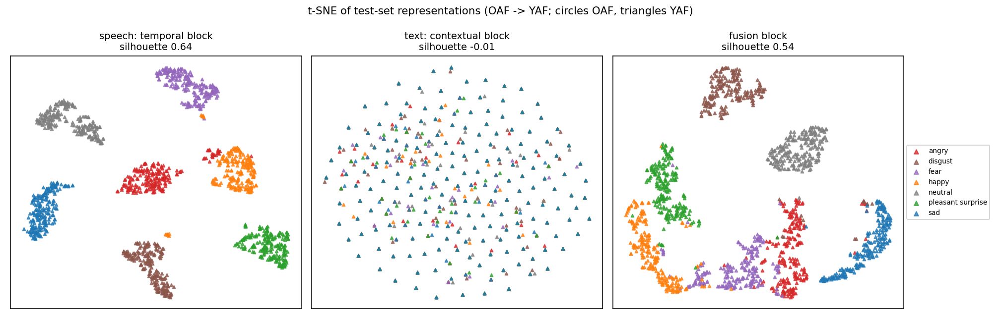

# Multimodal emotion recognition on TESS (Assignment 2b)

Three emotion classifiers on the Toronto emotional speech set (TESS): **speech only**, **text only** and
**speech + text (fusion)**. Each follows the assignment's blocks: preprocessing, feature extraction,
temporal/contextual modelling, fusion and a classifier.

Report: [`report/report.pdf`](report/report.pdf). All numbers: [`Results/`](Results).

## Results

Test accuracy (%), mean ± SD over 3 seeds (chance 14.3 %):

| Model | Unseen words | OAF → YAF | YAF → OAF |
|---|---|---|---|
| **Speech** (WavLM + BiLSTM) | **99.8 ± 0.2** | **65.4 ± 7.3** | **60.2 ± 1.9** |
| Speech, log-mel features | 99.4 ± 0.3 | 32.2 ± 4.3 | 35.9 ± 1.4 |
| Speech, per-speaker normalised | 99.9 ± 0.1 | 56.4 ± 4.2 | 51.3 ± 1.5 |
| **Text** (BERT + Transformer) | 14.3 ± 0.0 | 14.3 ± 0.0 | 14.3 ± 0.0 |
| **Fusion** (gated, GMU) | 99.1 ± 0.1 | 59.5 ± 11.2 | 57.0 ± 2.7 |
| Fusion, concatenation | 99.8 ± 0.1 | 57.6 ± 11.1 | 45.9 ± 8.1 |
| Fusion, cross-modal attention | 99.5 ± 0.2 | 52.1 ± 12.4 | 52.1 ± 1.7 |

- **The text carries no emotion in TESS.** Every clip says "Say the word ___" and each sentence occurs once per
  emotion, so no text-only model can beat 1/7. Ours, and a pretrained text-emotion classifier, score exactly 14.3 %.
- **Fusion relies entirely on speech.** Swapping each test clip's text for another's leaves fusion accuracy
  unchanged; swapping its speech drops it to chance. The fusion gate takes 83–85 % from speech.
- **Known voice: easy; new voice: hard.** 99.8 % on unseen words, 60–65 % on an unseen speaker. Fear, neutral and
  sad transfer to a new voice (96–100 % recall); angry, happy and surprise do not (8–57 %).
- **A new voice needs only a few labels.** The speech model's representations already separate the unseen speaker's
  emotions: k-means (no labels) groups them so that the best naming of the clusters puts 96 % of YAF's clips in their
  own emotion (a ceiling, since the naming uses the true labels). One labelled clip per emotion of the new speaker raises
  accuracy from 65 % to 92 % (YAF) and from 60 % to 79 % (OAF); five per emotion reach 98 % and 92 %.
- **Noise:** at 0 dB SNR the cross-modal attention model keeps 70.6 % against 50.3 % for speech alone, but its text is
  shuffle-proof, so the gain comes from its extra attention pooling over the speech frames, not from the words.
- **Speaker augmentation** (training voice pitch-shifted ±3 semitones and sped up/slowed 0.9×/1.1×) adds 20 points
  to log-mel features from OAF to YAF (32.2 → 52.5 %) and 5 the other way, but little to WavLM (61.7 → 62.4 % and
  58.2 → 61.5 %), which already transfers far better across voices; from OAF to YAF it narrows the seed spread
  (±12.1 → ±2.8). Results in
  [`Results_aug/`](Results_aug), notebook `kaggle/TESS_augmentation.ipynb`.
- **Two additions did not work:** per-speaker normalisation lowered cross-speaker accuracy by 9 points, and
  cross-modal attention learned one shared temporal pooling instead of a word-to-audio alignment.



## Architecture

| Block | Speech | Text |
|---|---|---|
| Preprocessing | mono 16 kHz, leading/trailing silence trimmed (30 dB), peak-normalised, at most 4 s | lower case, punctuation removed, BERT WordPiece tokens |
| Feature extraction (frozen) | WavLM Base+ hidden states of all 13 layers (T × 768, 20 ms frames); log-mel (T × 64) as an ablation | BERT base hidden states of all 13 layers (tokens × 768) |
| Temporal / contextual modelling | learned layer weights → 2-layer BiLSTM (2 × 128) → attention pooling | learned layer weights → 1 Transformer encoder layer (4 heads) → attention pooling |
| Fusion | gated multimodal unit (GMU) over the two 256-d vectors; plain concatenation as an ablation | |
| Classifier | 256 → 128 → 7, ReLU, dropout 0.3 | same |

Only the small heads train (about 1–2 M parameters); WavLM and BERT stay frozen and their features are cached.

## Experiments

TESS has 2,800 clips: two actresses (OAF, aged 64; YAF, aged 26) say *"Say the word ___"* with 200 target words in
7 emotions (angry, disgust, fear, happy, neutral, pleasant surprise, sad). The sentence is the same for every
emotion, so **the text carries no information about the emotion**. The splits are built to show this rather than
hide it:

| Split | Train / validation | Test |
|---|---|---|
| `word` (unseen words) | 140 / 30 words, both speakers | the other 30 words, both speakers (420 clips) |
| `oaf2yaf` | OAF only (held-out words for validation) | all 1,400 YAF clips: an unseen voice |
| `yaf2oaf` | YAF only | all 1,400 OAF clips |

Every variant runs with 3 seeds. The fusion model is also tested with the speech or the text of each clip swapped for
that of a random other clip, which shows which modality it actually uses. The speech and fusion models are also
tested with white noise added to the test speech (20, 10 and 0 dB SNR).

### Beyond the brief

- **How good can text possibly be?** A text model gives every clip of a sentence the same answer, and each TESS
  sentence occurs once per emotion and speaker, so no text-only model can beat 1/7. `scripts/text_zero_shot.py`
  computes this bound from the data and also runs a pretrained text-emotion classifier
  (`j-hartmann/emotion-english-distilroberta-base`) on every sentence.
- **Unsupervised speaker normalisation** (`speech_spknorm`): each speaker's WavLM features are standardised with
  that speaker's own statistics, computed without labels, so a new voice can be normalised from its unlabelled
  recordings. Aimed at the cross-speaker splits.
- **Cross-modal attention fusion** (`fusion_xattn`): each text token attends over the speech frames. The text cannot
  tell the emotion, but it can tell the model where to listen; the attention maps show where each token looks.

| Variant | Speech features | Text | Fusion |
|---|---|---|---|
| `speech` | WavLM | – | – |
| `speech_logmel` | log-mel | – | – |
| `speech_spknorm` | WavLM, per-speaker normalised | – | – |
| `text` | – | BERT | – |
| `fusion` | WavLM | BERT | GMU |
| `fusion_concat` | WavLM | BERT | concatenation |
| `fusion_xattn` | WavLM | BERT | cross-modal attention |

## Repository layout

```
common/                  data (TESS, transcripts, splits), features, networks, training code
models/speech_pipeline/  train.py, test.py
models/text_pipeline/    train.py, test.py
models/fusion_pipeline/  train.py, test.py
scripts/extract_features.py   preprocessing + cached features
scripts/run_all.py            every variant x split x seed
scripts/make_results.py       accuracy tables and plots
scripts/text_zero_shot.py     upper bound for any text model + pretrained text-emotion classifier
scripts/few_shot_adaptation.py  cluster purity and few-shot accuracy on the unseen speaker (CPU, from saved reps)
scripts/extract_augmented.py  features for the speaker-augmentation experiment (layer-mean WavLM, log-mel, 4 augmented copies)
kaggle/                  build_notebook.py, the notebook (TESS_emotion.ipynb) and the executed run (TESS_emotion_executed.ipynb)
Results/                 accuracy tables (*.md, *.csv), plots/, runs/<variant>/<split>/seed<k>/
Results_aug/             the speaker-augmentation experiment (cross-speaker splits)
report/                  the report (PDF + LaTeX)
```

## How to run

```bash
pip install -r requirements.txt
# TESS from Kaggle: https://www.kaggle.com/datasets/ejlok1/toronto-emotional-speech-set-tess
python scripts/extract_features.py --tess /path/to/TESS --out features      # downloads WavLM Base+ and BERT
python scripts/run_all.py --features features --results Results --seeds 0 1 2
python scripts/text_zero_shot.py --features features --results Results
python scripts/make_results.py --results Results
python scripts/few_shot_adaptation.py --results Results
```

One pipeline on its own:

```bash
python models/speech_pipeline/train.py --features features --split word --seed 0 --out Results/runs/speech/word/seed0
python models/speech_pipeline/test.py  --features features --run Results/runs/speech/word/seed0
python models/fusion_pipeline/train.py --features features --split oaf2yaf --seed 0 --out runs/fusion_oaf2yaf
python models/fusion_pipeline/test.py  --features features --run runs/fusion_oaf2yaf
```

`--speech_features logmel` and `--fusion concat` select the ablations. The results in this repository come from
`kaggle/TESS_emotion.ipynb` on a Kaggle T4 GPU (about 1.5 to 2 hours); a GPU is not required but makes feature
extraction much faster.

## Credits

TESS: Dupuis & Pichora-Fuller, University of Toronto (2010). WavLM Base+ (Microsoft) and BERT base (Google) from
Hugging Face. Gated multimodal unit: Arevalo et al. (2017).
